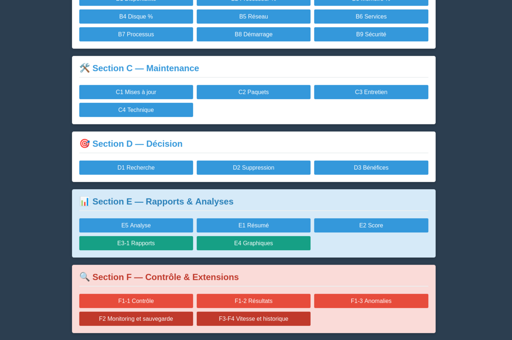
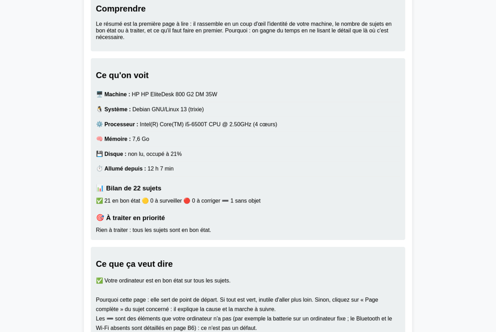
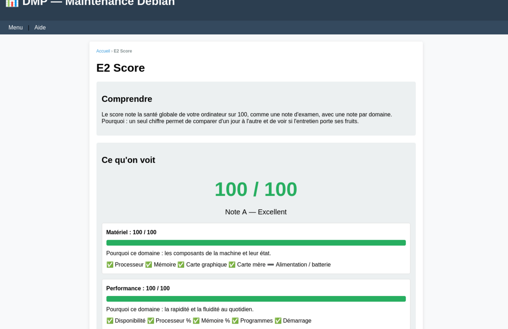

# DMP — Debian Maintenance Professionnel

DMP aide les utilisateurs de **Debian GNU/Linux**, même débutants, à comprendre, suivre et entretenir leur machine.

Chaque page suit le même cycle : **observation → compréhension → explication → décision de l'utilisateur**. DMP observe et explique en langage simple. Il ne modifie jamais le système de lui-même.

## Aperçu

**Le menu d'accueil** : toutes les sections d'un coup d'œil.



**Chaque page explique** : ce que c'est, ce que DMP voit sur votre machine, et ce que cela veut dire.



**Un score sur 100** qui résume l'état de votre machine.



## Fonctionnement

Chaque page affiche quatre blocs :

1. **Comprendre** : de quoi on parle, en mots simples
2. **Ce qu'on voit** : les données réelles de votre machine, avec le pourquoi
3. **Ce que ça veut dire** : l'interprétation
4. **Infos techniques** : commandes et valeurs brutes (« DMP uniquement »)

## Sections

| Section | Contenu |
|---------|---------|
| A | Matériel : processeur, mémoire, disques, réseau, carte graphique, USB, alimentation… |
| B | Activité en temps réel : disponibilité, utilisation, services, processus, démarrage, sécurité |
| C | Maintenance : mises à jour, paquets, entretien, noyau |
| D | Aide à la décision : recherche, suppression prudente, bénéfices |
| E | Résumé, score et analyse |
| F | Contrôle qualité, sauvegarde, benchmark, historique |

## Prérequis et compatibilité

- **Testé** : Debian 13 (Python 3.13)
- **Compatibles en principe, non testés** : Debian 11 et 12, Ubuntu et dérivés (`apt`, `dpkg`, `systemd`)
- **Non compatibles** : Windows, macOS, Fedora, Arch (DMP s'appuie sur `apt`, `dpkg` et `systemd`)
- Python 3 et les outils courants (`lsblk`, `df`, `ip`, `ss`, `free`, `journalctl`), présents par défaut
- `lspci` et `lsusb` : si absents, `sudo apt install pciutils usbutils`
- `smartmontools` (santé des disques) : `sudo apt install smartmontools`, puis la règle sudo décrite dans « Santé des disques (SMART) » ci-dessous

## Installation

```bash
git clone https://github.com/MchCvs/DMP.git ~/DMP
bash ~/DMP/install.sh
```

DMP démarre ensuite automatiquement à chaque session. Ouvrir : <http://127.0.0.1:8765/> ou l'icône **DMP** du menu des applications.

Ne supprimez pas le dossier `~/DMP`. Mise à jour : `cd ~/DMP && git pull && systemctl --user restart dmp.service`. Désinstallation : `bash ~/DMP/uninstall.sh`.

### Méthode B : paquet Debian (.deb)

Téléchargez `dmp_1.8.3-1_all.deb` depuis la [page des releases](https://github.com/MchCvs/DMP/releases/latest), puis :

```
sudo apt install ./dmp_1.8.3-1_all.deb
systemctl --user enable --now dmp.service
```

Ouvrir : http://127.0.0.1:8765/ ou l'icône DMP du menu des applications.
Mise à jour : installez le nouveau `.deb` de la même façon, puis `systemctl --user restart dmp.service`.
Désinstallation : `systemctl --user disable --now dmp.service && sudo apt remove dmp`. Vos données dans `~/.local/share/dmp` sont conservées.

Choisissez la méthode A (git, ci-dessus) ou la méthode B, pas les deux.

## Structure

```
modules/collecteurs/   scripts bash qui collectent les données (JSON)
web/server/            serveur Python (API)
web/html/              pages web
```

### Santé des disques (SMART)

La page de santé des disques lit les données SMART, fournies par `smartmontools`.
Lire ces données demande les droits administrateur, mais DMP ne demande jamais
de mot de passe : il utilise `sudo -n`, qui échoue au lieu de bloquer.

Autorisez uniquement la lecture SMART, avec `sudo visudo` ou un fichier dans
`/etc/sudoers.d/` :

    votre_utilisateur ALL=(root) NOPASSWD: /usr/sbin/smartctl

Sans cette règle, la page signale que les données SMART sont indisponibles.
Ce n'est pas une panne du disque, c'est un problème d'accès.

## Sécurité et vie privée

- Mode web (`127.0.0.1:8765`) : lecture seule. Aucune action sur le système, sauf le test de vitesse, qui écrit 64 Mo temporaires dans votre dossier personnel et les supprime aussitôt.
- Mode terminal (`modules/bin/dmp`) : peut agir sur le système, uniquement après votre confirmation. Chaque action demande un « o » explicite, avec « N » par défaut :
  - réparer les paquets interrompus (`sudo dpkg --configure -a`) ;
  - rafraîchir la liste des paquets (`sudo apt update`) ;
  - installer les mises à jour (`sudo apt upgrade`) ;
  - supprimer les paquets inutiles (`sudo apt autoremove`) ;
  - vider le cache des paquets (`sudo apt autoclean`) ;
  - réduire les journaux à 30 jours (`sudo journalctl --vacuum-time=30d`) ;
  - supprimer les miniatures du dossier `~/.cache/thumbnails`.
  Les droits administrateur sont demandés par `sudo`, avec votre mot de passe.
  La lecture de l'état des disques (SMART) ne modifie rien : elle demande seulement les droits administrateur, sans question supplémentaire.
- Aucune donnée envoyée sur Internet : tout reste sur votre machine
- Serveur accessible uniquement depuis votre ordinateur

## Contribuer

DMP est un projet communautaire. Les contributions sont bienvenues : bug reports, features, traductions, documentation. Lis [CONTRIBUTING.md](CONTRIBUTING.md) pour commencer.

## Licence

[GPL-3.0-or-later](LICENSE) : logiciel libre, gratuit, modifiable et redistribuable sous la même licence, avec mention de l'auteur.

## Auteur

Créé par Thierry CHEVASSUS, Piton Sainte Rose, île de la Réunion, France.
